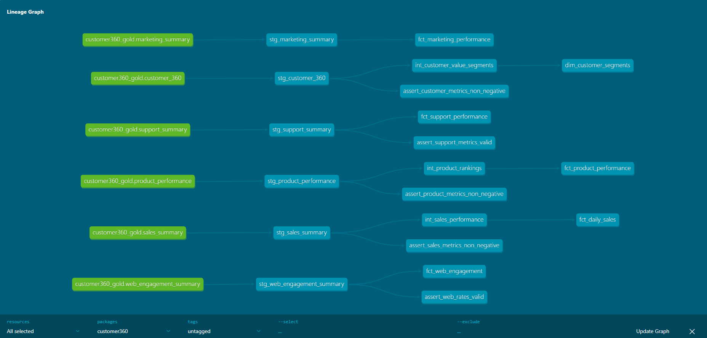

# Customer 360 Analytics Lakehouse


## Table of Contents

1. [Project Overview](#project-overview)
2. [Business Problem](#business-problem)
3. [Project Objectives](#project-objectives)
4. [Solution Summary](#solution-summary)
5. [Architecture](#architecture)
6. [Technology Stack](#technology-stack)
7. [Dataset Overview](#dataset-overview)
8. [Repository Structure](#repository-structure)
9. [Environment and Prerequisites](#environment-and-prerequisites)
10. [Environment Variables](#environment-variables)
11. [Docker Infrastructure](#docker-infrastructure)
12. [Data Generation](#data-generation)
13. [Landing Layer](#landing-layer)
14. [Bronze Layer](#bronze-layer)
15. [Silver Layer](#silver-layer)
16. [Gold Layer](#gold-layer)
17. [DuckDB Integration](#duckdb-integration)
18. [dbt Analytics Engineering Layer](#dbt-analytics-engineering-layer)
19. [Data Quality and Testing](#data-quality-and-testing)
20. [dbt Documentation and Lineage](#dbt-documentation-and-lineage)
21. [Power BI Dashboard](#power-bi-dashboard)
22. [Dashboard Measures](#dashboard-measures)
23. [Pipeline Verification](#pipeline-verification)
24. [How to Run the Project](#how-to-run-the-project)
25. [Common Issues and Troubleshooting](#common-issues-and-troubleshooting)
26. [Engineering Decisions](#engineering-decisions)
27. [Business Insights](#business-insights)
28. [Security and Configuration](#security-and-configuration)
29. [Performance Considerations](#performance-considerations)
30. [Limitations](#limitations)
31. [Future Improvements](#future-improvements)
32. [Skills Demonstrated](#skills-demonstrated)
33. [Portfolio Presentation](#portfolio-presentation)
34. [Author](#author)
35. [License](#license)

---

## Project Overview

The **Customer 360 Analytics Lakehouse** is an end-to-end data engineering and analytics project that demonstrates how data from multiple business systems can be collected, validated, transformed, modelled, tested, documented, and presented through business intelligence dashboards.

The platform combines customer, order, payment, product, marketing, support, and web-interaction data to create a unified view of customer behaviour and business performance.

The project implements a modern lakehouse architecture using:

- Python for synthetic data generation and utility scripts
- Apache Spark for distributed data processing
- Delta Lake for ACID-compliant analytical storage
- MinIO for S3-compatible object storage
- Docker Compose for local infrastructure management
- DuckDB for lightweight analytical querying
- dbt for analytics engineering and dimensional modelling
- Power BI for reporting and business intelligence

The complete data flow is:

```text
Synthetic Business Data
        ↓
Landing CSV Files
        ↓
Apache Spark Bronze Ingestion
        ↓
Bronze Delta Tables
        ↓
Spark Cleaning, Validation and Deduplication
        ↓
Silver Delta Tables
        ↓
Spark Business Aggregations
        ↓
Gold Delta Tables
        ↓
DuckDB
        ↓
dbt Sources
        ↓
dbt Staging Models
        ↓
dbt Intermediate Models
        ↓
dbt Business Marts
        ↓
Power BI Dashboard
```

The final platform contains:

- 8 source datasets
- 8 Bronze Delta datasets
- 8 Silver Delta datasets
- 6 Gold analytical datasets
- 6 dbt source definitions
- 6 dbt staging models
- 3 dbt intermediate models
- 6 dbt mart models
- 15 total dbt models
- 60 automated dbt tests
- 6 Power BI dashboard pages
- 2,000 consolidated customer records in the final Customer 360 dataset

---

## Business Problem

Customer information is commonly distributed across different operational systems.

A typical organisation may use separate platforms for:

- Customer relationship management
- Product management
- Order processing
- Payment processing
- Marketing campaigns
- Customer support
- Website analytics

When these systems are not integrated, decision-makers cannot easily answer important questions such as:

- Who are the organisation’s highest-value customers?
- Which customers purchase most frequently?
- Which products generate the highest revenue?
- How much order value has been successfully collected?
- Which campaigns generate conversions?
- Which marketing channels perform best?
- How efficiently are customer-support tickets resolved?
- How satisfied are customers with support services?
- How many users visit the website and complete purchases?
- How does customer engagement change over time?

The absence of a centralised and tested analytical platform creates several problems:

1. Customer data remains fragmented across systems.
2. Reports may produce inconsistent figures.
3. Duplicate and invalid records reduce trust.
4. Analysts spend excessive time manually combining datasets.
5. Business teams lack a unified view of customer activity.
6. Data-quality issues may remain undetected.
7. Dashboard metrics may not have traceable lineage.

---

## Project Objectives

The objectives of this project were to:

1. Simulate multiple operational business systems using realistic synthetic datasets.
2. Build a reusable data-ingestion framework with Apache Spark.
3. Store data in a medallion-style lakehouse architecture.
4. Use Delta Lake for transactional and schema-aware data storage.
5. Use MinIO as local S3-compatible object storage.
6. Apply data cleaning, type conversion, validation, and deduplication.
7. Quarantine invalid records rather than silently discarding them.
8. Build business-ready Gold datasets.
9. Query Delta Lake tables through DuckDB.
10. Build modular analytics models using dbt.
11. Apply automated data-quality and business-rule tests.
12. Generate dbt documentation and lineage.
13. Export analytics-ready datasets for Power BI.
14. Build a multi-page executive dashboard.
15. Package the project as a professional data engineering portfolio project.

---

## Solution Summary

The solution follows a layered architecture.

### Operational data simulation

Python scripts generate synthetic datasets representing customer, sales, payment, marketing, support, and web systems.

### Landing zone

Generated files are written to a landing area before being ingested into the lakehouse.

### Bronze layer

Spark reads each source dataset using an explicit schema and writes it to Delta Lake with minimal transformation. The Bronze layer preserves the source data while adding ingestion metadata.

### Silver layer

Spark standardises column names, converts data types, validates required fields, removes duplicate records, validates numeric values, and separates invalid records into quarantine storage.

### Gold layer

Spark creates business-facing analytical datasets for customer intelligence, sales, product performance, marketing, support, and web engagement.

### Analytics engineering

DuckDB reads the Gold Delta tables from MinIO. dbt then creates staging views, reusable intermediate models, and final fact and dimension tables.

### Data quality

dbt applies schema tests and custom business-rule tests. The completed project contains 60 automated tests.

### Business intelligence

The final marts are exported to CSV and Parquet and loaded into Power BI. Six report pages provide executive and operational insights.

---

## Architecture

### Logical Architecture

```text
┌───────────────────────────────────────────────────────────────┐
│                    DATA SOURCE SIMULATION                     │
│                                                               │
│  CRM Customers | Products | Orders | Order Items | Payments  │
│  Marketing Events | Support Tickets | Web Events             │
└──────────────────────────────┬────────────────────────────────┘
                               │
                               ▼
┌───────────────────────────────────────────────────────────────┐
│                         LANDING LAYER                         │
│                                                               │
│            Raw CSV files generated by Python                 │
└──────────────────────────────┬────────────────────────────────┘
                               │
                               ▼
┌───────────────────────────────────────────────────────────────┐
│                         BRONZE LAYER                          │
│                                                               │
│  Spark ingestion | Explicit schemas | Delta format           │
│  Source preservation | Ingestion metadata                    │
└──────────────────────────────┬────────────────────────────────┘
                               │
                               ▼
┌───────────────────────────────────────────────────────────────┐
│                         SILVER LAYER                          │
│                                                               │
│  Cleaning | Standardisation | Type conversion                │
│  Required-field validation | Deduplication                   │
│  Numeric validation | Invalid-record quarantine              │
└──────────────────────────────┬────────────────────────────────┘
                               │
                               ▼
┌───────────────────────────────────────────────────────────────┐
│                          GOLD LAYER                           │
│                                                               │
│  Customer 360 | Sales Summary | Product Performance          │
│  Marketing Summary | Support Summary | Web Engagement        │
└──────────────────────────────┬────────────────────────────────┘
                               │
                               ▼
┌───────────────────────────────────────────────────────────────┐
│                    ANALYTICS ENGINEERING                      │
│                                                               │
│             DuckDB → dbt Sources → Staging                   │
│              → Intermediate Models → Marts                   │
└──────────────────────────────┬────────────────────────────────┘
                               │
                               ▼
┌───────────────────────────────────────────────────────────────┐
│                    BUSINESS INTELLIGENCE                      │
│                                                               │
│                     Power BI Dashboard                       │
└───────────────────────────────────────────────────────────────┘
```

### Infrastructure Architecture

The local development environment is containerised with Docker Compose.

```text
Docker Compose
│
├── MinIO
│   ├── S3-compatible API: port 9000
│   └── MinIO Console: port 9001
│
├── Spark Master
│   ├── Cluster port: 7077
│   └── Spark Master UI: port 8081
│
├── Spark Worker
│   └── Spark Worker UI: port 8082
│
└── dbt + DuckDB
    └── dbt documentation: port 8085
```

---

## Technology Stack

| Layer | Technology | Purpose |
|---|---|---|
| Programming | Python 3.12 | Data generation, validation, exports and utility scripts |
| Distributed processing | Apache Spark 3.5.5 | Ingestion, transformation and aggregation |
| Table format | Delta Lake 3.3.2 | ACID transactions, schema support and versioned data storage |
| Object storage | MinIO | Local S3-compatible lakehouse storage |
| File formats | CSV, Parquet and Delta | Landing, exchange and analytical storage formats |
| Query engine | DuckDB | Local analytical SQL engine |
| Analytics engineering | dbt Core | SQL modelling, tests, documentation and lineage |
| dbt adapter | dbt-duckdb | DuckDB integration |
| Containerisation | Docker and Docker Compose | Reproducible local infrastructure |
| Business intelligence | Power BI | Interactive dashboards and business reporting |
| Version control | Git and GitHub | Source control and portfolio publication |
| Development environment | Visual Studio Code | Code development and project management |
| Command line | Windows PowerShell | Pipeline execution and infrastructure management |

---

## Dataset Overview

The platform processes eight datasets.

| Dataset | Description | Example grain |
|---|---|---|
| `crm_customers` | Customer demographic and profile data | One row per customer |
| `products` | Product catalogue and pricing data | One row per product |
| `orders` | Customer order headers | One row per order |
| `order_items` | Individual items associated with orders | One row per order item |
| `payments` | Payment attempts and payment outcomes | One row per payment |
| `marketing_events` | Campaign interactions and conversions | One row per marketing event |
| `support_tickets` | Customer-support issues and resolutions | One row per support ticket |
| `web_events` | Website behaviour and session events | One row per web event |

### Core Entity Relationships

```text
customers
   │
   ├── orders
   │      ├── order_items
   │      └── payments
   │
   ├── marketing_events
   │
   ├── support_tickets
   │
   └── web_events
```

### Main Identifiers

| Domain | Identifier |
|---|---|
| Customer | `customer_id` or customer email |
| Product | `product_id` |
| Order | `order_id` |
| Order item | order-item identifier |
| Payment | `payment_id` |
| Marketing event | `event_id` |
| Support ticket | `ticket_id` |
| Web event | `event_id` |

---

## Repository Structure

The exact structure may evolve as the project develops, but the completed repository follows this general organisation:

```text
customer-360-lakehouse/
│
├── airflow/
│   └── # Airflow orchestration assets and future DAGs
│
├── config/
│   └── # Project configuration files
│
├── dashboard/
│   ├── powerbi/
│   │   └── customer_360_executive_dashboard.pbix
│   └── # Dashboard-related documentation
│
├── data_generator/
│   ├── # Synthetic data-generation modules
│   └── # Generated source-data logic
│
├── dbt_customer360/
│   ├── Dockerfile
│   ├── dbt_project.yml
│   ├── profiles.yml.example
│   ├── macros/
│   ├── models/
│   │   ├── sources.yml
│   │   ├── staging/
│   │   │   ├── stg_customer_360.sql
│   │   │   ├── stg_sales_summary.sql
│   │   │   ├── stg_product_performance.sql
│   │   │   ├── stg_marketing_summary.sql
│   │   │   ├── stg_support_summary.sql
│   │   │   ├── stg_web_engagement_summary.sql
│   │   │   └── staging.yml
│   │   │
│   │   ├── intermediate/
│   │   │   ├── int_customer_value_segments.sql
│   │   │   ├── int_sales_performance.sql
│   │   │   ├── int_product_rankings.sql
│   │   │   └── intermediate.yml
│   │   │
│   │   └── marts/
│   │       ├── dim_customer_segments.sql
│   │       ├── fct_daily_sales.sql
│   │       ├── fct_product_performance.sql
│   │       ├── fct_marketing_performance.sql
│   │       ├── fct_support_performance.sql
│   │       ├── fct_web_engagement.sql
│   │       └── marts.yml
│   │
│   ├── tests/
│   │   ├── assert_customer_metrics_non_negative.sql
│   │   ├── assert_sales_metrics_non_negative.sql
│   │   ├── assert_product_metrics_non_negative.sql
│   │   ├── assert_support_metrics_valid.sql
│   │   └── assert_web_rates_valid.sql
│   │
│   ├── test_minio_delta.py
│   ├── inspect_marts.py
│   ├── validate_dashboard.py
│   ├── export_marts.py
│   └── dashboard_exports/
│
├── lakehouse/
│   ├── bronze/
│   ├── silver/
│   ├── gold/
│   ├── landing/
│   └── quarantine/
│
├── spark/
│   ├── bronze/
│   │   ├── datasets.py
│   │   ├── schemas.py
│   │   ├── ingest_bronze.py
│   │   ├── verify_bronze.py
│   │   └── smoke_test.py
│   │
│   ├── silver/
│   │   ├── datasets.py
│   │   ├── transforms.py
│   │   ├── validators.py
│   │   ├── process_silver.py
│   │   ├── inspect_bronze.py
│   │   ├── inspect_orphans.py
│   │   └── verify_silver.py
│   │
│   ├── gold/
│   │   ├── datasets.py
│   │   ├── metrics.py
│   │   ├── process_gold.py
│   │   └── verify_gold.py
│   │
│   └── common/
│       ├── spark_session.py
│       ├── quality.py
│       └── audit.py
│
├── screenshots/
│   ├── architecture/
│   ├── dbt/
│   └── dashboard/
│
├── sql/
│   └── audit_tables.sql
│
├── tests/
│   └── # Python and pipeline tests
│
├── .env.example
├── .gitignore
├── docker-compose.yml
├── Makefile
├── requirements.txt
└── README.md
```

---

## Environment and Prerequisites

Install the following before running the project:

- Git
- Python 3.12 or a compatible Python version
- Docker Desktop
- Docker Compose
- Visual Studio Code
- Power BI Desktop
- Windows PowerShell or another compatible terminal

### Recommended machine resources

For comfortable local execution:

- At least 8 GB RAM
- At least 4 logical CPU cores
- At least 10 GB free disk space
- Hardware virtualisation enabled
- WSL 2 enabled on Windows
- Docker Desktop configured to use the WSL 2 backend

---

## Environment Variables

Create a `.env` file in the project root.

Example:

```env
MINIO_ROOT_USER=customer360_admin
MINIO_ROOT_PASSWORD=customer360_password

MINIO_ACCESS_KEY=customer360_admin
MINIO_SECRET_KEY=customer360_password

MINIO_BUCKET=customer360
MINIO_ENDPOINT=http://minio:9000

AWS_ACCESS_KEY_ID=customer360_admin
AWS_SECRET_ACCESS_KEY=customer360_password
AWS_DEFAULT_REGION=us-east-1
```

Use strong credentials outside local development.

Do not commit the real `.env` file.

Commit an example instead:

```text
.env.example
```

### Example `.env.example`

```env
MINIO_ROOT_USER=replace_with_minio_username
MINIO_ROOT_PASSWORD=replace_with_strong_password

MINIO_ACCESS_KEY=replace_with_access_key
MINIO_SECRET_KEY=replace_with_secret_key

MINIO_BUCKET=customer360
MINIO_ENDPOINT=http://minio:9000

AWS_ACCESS_KEY_ID=replace_with_access_key
AWS_SECRET_ACCESS_KEY=replace_with_secret_key
AWS_DEFAULT_REGION=us-east-1
```

---

## Docker Infrastructure

The project uses Docker Compose to provide a reproducible local environment.

### Main services

#### MinIO

MinIO acts as the object-storage layer.

It stores:

```text
customer360/
├── landing/
├── bronze/
├── silver/
├── gold/
└── quarantine/
```

Access points:

```text
MinIO API:
http://localhost:9000

MinIO Console:
http://localhost:9001
```

#### Spark master

The Spark master coordinates distributed Spark jobs.

```text
Spark master:
spark://spark-master:7077

Spark master UI:
http://localhost:8081
```

#### Spark worker

The worker executes Spark tasks.

```text
Spark worker UI:
http://localhost:8082
```

#### dbt and DuckDB

The dbt container contains:

- dbt Core
- dbt-duckdb
- DuckDB
- HTTPFS extension
- Delta extension
- Project files mounted from the host

dbt documentation is exposed on:

```text
http://localhost:8085
```

### Start the infrastructure

From the project root:

```powershell
docker compose up -d
```

### Check service status

```powershell
docker compose ps
```

Expected services should show an `Up` or `Running` status.

### Check resource usage

```powershell
docker stats --no-stream
```

### Stop the environment

```powershell
docker compose stop
```

### Stop and remove containers

```powershell
docker compose down
```

Avoid using the following unless you intentionally want to remove persistent volumes:

```powershell
docker compose down -v
```

---

## Data Generation

Synthetic datasets are generated to simulate business activity across multiple systems.

The generation layer is responsible for:

- Creating realistic identifiers
- Connecting customers to orders
- Connecting orders to order items
- Connecting orders to payments
- Generating product pricing
- Generating marketing interactions
- Generating customer-support tickets
- Generating website sessions and events
- Producing controlled duplicate and invalid records where required for testing

### Why synthetic data was used

Synthetic data makes it possible to:

- Demonstrate end-to-end processing without exposing private data
- Reproduce the pipeline consistently
- Introduce deliberate quality issues
- Test validation and quarantine processes
- Control dataset volumes
- Publish the repository publicly

### Run the data generator

Run the relevant generation entry point from the project root.

Example:

```powershell
python data_generator/generate_data.py
```

If the project uses a differently named entry script, replace the command with the actual file name.

### Confirm generated files

Inspect the landing directory:

```powershell
Get-ChildItem .\lakehouse\landing
```

Or inspect the MinIO landing path through the MinIO Console:

```text
http://localhost:9001
```

---

## Landing Layer

The Landing layer contains source extracts before Spark converts them into Delta tables.

Typical landing files include:

```text
crm_customers.csv
products.csv
orders.csv
order_items.csv
payments.csv
marketing_events.csv
support_tickets.csv
web_events.csv
```

The Landing layer provides:

- A clear separation between source extraction and processing
- Reproducibility
- Easier debugging
- Source-file traceability
- A stable ingestion boundary

Landing data should be treated as immutable for a given pipeline run.

---

## Bronze Layer

The Bronze layer stores source-aligned data in Delta format.

### Bronze responsibilities

The Bronze pipeline:

1. Reads landing files.
2. Uses explicit Spark schemas.
3. Preserves source columns.
4. Adds ingestion metadata.
5. Writes Delta tables to MinIO.
6. Validates source and written row counts.
7. Produces an ingestion summary.

### Bronze schemas

Schemas are defined in:

```text
spark/bronze/schemas.py
```

The project uses explicit schemas instead of relying entirely on schema inference.

Benefits include:

- Predictable data types
- Reduced inference errors
- Better handling of malformed records
- Consistent schemas across pipeline runs
- Easier schema validation

### Bronze dataset configuration

Dataset metadata is stored in:

```text
spark/bronze/datasets.py
```

Configuration may include:

- Dataset name
- Source file
- Target path
- Schema
- Expected columns
- Primary key
- Timestamp columns

### Bronze ingestion script

The main Bronze processing logic is implemented in:

```text
spark/bronze/ingest_bronze.py
```

The script:

- Creates a Spark session
- Connects Spark to MinIO using the S3A connector
- Loads the selected dataset
- Applies the explicit schema
- Adds ingestion metadata
- Writes the result in Delta format
- Verifies that the written row count matches expectations
- Prints a processing summary

### Bronze storage paths

```text
s3a://customer360/bronze/crm_customers
s3a://customer360/bronze/products
s3a://customer360/bronze/orders
s3a://customer360/bronze/order_items
s3a://customer360/bronze/payments
s3a://customer360/bronze/marketing_events
s3a://customer360/bronze/support_tickets
s3a://customer360/bronze/web_events
```

### Run Bronze ingestion

The Spark job is submitted through the Spark master container.

A typical command is:

```powershell
docker exec customer360_spark_master `
    /opt/spark/bin/spark-submit `
    --master spark://spark-master:7077 `
    --deploy-mode client `
    --packages io.delta:delta-spark_2.12:3.3.2,org.apache.hadoop:hadoop-aws:3.3.4 `
    --conf spark.jars.ivy=/home/spark/.ivy2 `
    --conf spark.sql.extensions=io.delta.sql.DeltaSparkSessionExtension `
    --conf spark.sql.catalog.spark_catalog=org.apache.spark.sql.delta.catalog.DeltaCatalog `
    /opt/customer360/spark/bronze/ingest_bronze.py `
    --dataset all
```

To process a single dataset:

```powershell
docker exec customer360_spark_master `
    /opt/spark/bin/spark-submit `
    --master spark://spark-master:7077 `
    --deploy-mode client `
    --packages io.delta:delta-spark_2.12:3.3.2,org.apache.hadoop:hadoop-aws:3.3.4 `
    --conf spark.jars.ivy=/home/spark/.ivy2 `
    --conf spark.sql.extensions=io.delta.sql.DeltaSparkSessionExtension `
    --conf spark.sql.catalog.spark_catalog=org.apache.spark.sql.delta.catalog.DeltaCatalog `
    /opt/customer360/spark/bronze/ingest_bronze.py `
    --dataset orders
```

### Verify Bronze tables

The Bronze verification script is:

```text
spark/bronze/verify_bronze.py
```

Run:

```powershell
docker exec customer360_spark_master `
    /opt/spark/bin/spark-submit `
    --master spark://spark-master:7077 `
    --deploy-mode client `
    --packages io.delta:delta-spark_2.12:3.3.2,org.apache.hadoop:hadoop-aws:3.3.4 `
    --conf spark.jars.ivy=/home/spark/.ivy2 `
    --conf spark.sql.extensions=io.delta.sql.DeltaSparkSessionExtension `
    --conf spark.sql.catalog.spark_catalog=org.apache.spark.sql.delta.catalog.DeltaCatalog `
    /opt/customer360/spark/bronze/verify_bronze.py
```

A successful Bronze phase should confirm:

- Every expected dataset exists
- Delta transaction logs exist
- Every dataset can be read
- Required columns are present
- Row counts are greater than zero
- Source and written counts reconcile

---

## Silver Layer

The Silver layer contains cleaned, standardised, validated, and deduplicated records.

### Silver responsibilities

The Silver pipeline performs:

- Column-name standardisation
- Whitespace trimming
- Text normalisation
- Email normalisation
- Date and timestamp conversion
- Numeric conversion
- Required-column validation
- Non-negative metric validation
- Duplicate removal
- Invalid-record isolation
- Delta write validation

### Silver configuration

Dataset-specific Silver rules are stored in:

```text
spark/silver/datasets.py
```

A typical configuration contains:

```python
{
    "silver_name": "orders",
    "primary_key": "order_id",
    "deduplicate": True,
    "timestamp_candidates": [
        "updated_at",
        "created_at",
        "order_date",
        "_ingested_at",
    ],
    "required_columns": [
        "order_id",
        "customer_id",
    ],
}
```

### Common transformations

Reusable transformations are implemented in:

```text
spark/silver/transforms.py
```

Examples include:

- Normalising column names
- Trimming text columns
- Converting blank values to null
- Normalising customer emails
- Parsing timestamps
- Casting monetary columns
- Creating derived fields
- Applying dataset-specific cleaning

### Validation logic

Validation functions are implemented in:

```text
spark/silver/validators.py
```

Examples include:

- `assert_columns_exist`
- `validate_non_negative_columns`
- `split_valid_and_invalid`

### Deduplication

Duplicate records are removed using:

- A dataset-specific primary key
- The best available timestamp
- A window function
- Latest-record retention

The process gives preference to timestamp candidates such as:

```text
updated_at
created_at
event_timestamp
order_date
_ingested_at
```

### Quarantine

Records that fail required-field or business-rule validation are written to:

```text
s3a://customer360/quarantine/<dataset_name>
```

This prevents invalid records from entering analytical models while preserving them for investigation.

### Silver storage paths

```text
s3a://customer360/silver/customers
s3a://customer360/silver/products
s3a://customer360/silver/orders
s3a://customer360/silver/order_items
s3a://customer360/silver/payments
s3a://customer360/silver/marketing_events
s3a://customer360/silver/support_tickets
s3a://customer360/silver/web_events
```

### Run Silver processing

Process every dataset:

```powershell
docker exec customer360_spark_master `
    /opt/spark/bin/spark-submit `
    --master spark://spark-master:7077 `
    --deploy-mode client `
    --packages io.delta:delta-spark_2.12:3.3.2,org.apache.hadoop:hadoop-aws:3.3.4 `
    --conf spark.jars.ivy=/home/spark/.ivy2 `
    --conf spark.sql.extensions=io.delta.sql.DeltaSparkSessionExtension `
    --conf spark.sql.catalog.spark_catalog=org.apache.spark.sql.delta.catalog.DeltaCatalog `
    --conf spark.executor.cores=1 `
    --conf spark.executor.memory=1g `
    /opt/customer360/spark/silver/process_silver.py `
    --dataset all
```

Process one dataset:

```powershell
docker exec customer360_spark_master `
    /opt/spark/bin/spark-submit `
    --master spark://spark-master:7077 `
    --deploy-mode client `
    --packages io.delta:delta-spark_2.12:3.3.2,org.apache.hadoop:hadoop-aws:3.3.4 `
    --conf spark.jars.ivy=/home/spark/.ivy2 `
    --conf spark.sql.extensions=io.delta.sql.DeltaSparkSessionExtension `
    --conf spark.sql.catalog.spark_catalog=org.apache.spark.sql.delta.catalog.DeltaCatalog `
    /opt/customer360/spark/silver/process_silver.py `
    --dataset marketing_events
```

### Silver output summary

The Silver process reports:

- Bronze row count
- Valid rows before deduplication
- Duplicates removed
- Quarantined records
- Final Silver row count

### Verify Silver tables

Use:

```text
spark/silver/verify_silver.py
```

Run:

```powershell
docker exec customer360_spark_master `
    /opt/spark/bin/spark-submit `
    --master spark://spark-master:7077 `
    --deploy-mode client `
    --packages io.delta:delta-spark_2.12:3.3.2,org.apache.hadoop:hadoop-aws:3.3.4 `
    --conf spark.jars.ivy=/home/spark/.ivy2 `
    --conf spark.sql.extensions=io.delta.sql.DeltaSparkSessionExtension `
    --conf spark.sql.catalog.spark_catalog=org.apache.spark.sql.delta.catalog.DeltaCatalog `
    /opt/customer360/spark/silver/verify_silver.py
```

Verification checks include:

- Table existence
- Row-count validation
- Required-column validation
- Primary-key null checks
- Duplicate-key checks
- Numeric-value checks
- Delta readback validation

---

## Gold Layer

The Gold layer contains analytical datasets designed around business questions.

### Gold datasets

| Gold dataset | Purpose |
|---|---|
| `customer_360` | Unified customer profile with cross-domain metrics |
| `sales_summary` | Daily sales and payment performance |
| `product_performance` | Product revenue, orders, units sold and rankings |
| `marketing_summary` | Campaign and channel performance |
| `support_summary` | Ticket-resolution and satisfaction metrics |
| `web_engagement_summary` | Website traffic, sessions, visitors and conversion |

### Gold configuration

Gold dataset definitions are stored in:

```text
spark/gold/datasets.py
```

Configuration includes:

- Gold dataset name
- Description
- Primary key
- Required columns
- Partition columns

### Gold metrics

Reusable calculations are stored in:

```text
spark/gold/metrics.py
```

Examples include:

- Monetary conversion
- Text normalisation
- Average order value
- Customer classification
- Conversion-rate calculation
- Required-column checks
- First-existing-column selection

### Customer 360 dataset

The `customer_360` table combines customer-level information from multiple Silver datasets.

Typical metrics include:

- Customer ID
- Customer email
- Total orders
- Total revenue
- Average order value
- Total payments
- Marketing events
- Support tickets
- Web events
- Latest activity timestamps
- Customer-status attributes

The completed table contains:

```text
2,000 customer records
```

### Sales summary

The sales dataset provides daily metrics such as:

- Sales date
- Total orders
- Unique customers
- Gross order value
- Average order value
- Successful payments
- Successful payment amount

### Product performance

The product dataset contains:

- Product ID
- Units sold
- Total orders
- Product revenue
- Average selling price
- Revenue rank
- Product sales status

### Marketing summary

The marketing dataset contains campaign and channel metrics such as:

- Campaign ID
- Campaign name
- Channel
- Total events
- Campaign cost
- Conversions
- Conversion rate

### Support summary

The support dataset contains:

- Support group
- Priority
- Category
- Total tickets
- Resolved tickets
- Open tickets
- Unresolved tickets
- Resolution rate
- Average resolution time
- Average satisfaction
- Unique customers

### Web engagement summary

The web dataset contains:

- Engagement date
- Total events
- Unique sessions
- Unique visitors
- Page views
- Product views
- Cart events
- Checkout events
- Purchase events
- Converted sessions
- Session conversion rate
- Funnel rates

### Run Gold processing

Process every Gold dataset:

```powershell
docker exec customer360_spark_master `
    /opt/spark/bin/spark-submit `
    --master spark://spark-master:7077 `
    --deploy-mode client `
    --packages io.delta:delta-spark_2.12:3.3.2,org.apache.hadoop:hadoop-aws:3.3.4 `
    --conf spark.jars.ivy=/home/spark/.ivy2 `
    --conf spark.sql.extensions=io.delta.sql.DeltaSparkSessionExtension `
    --conf spark.sql.catalog.spark_catalog=org.apache.spark.sql.delta.catalog.DeltaCatalog `
    /opt/customer360/spark/gold/process_gold.py `
    --dataset all
```

Process a single Gold dataset:

```powershell
docker exec customer360_spark_master `
    /opt/spark/bin/spark-submit `
    --master spark://spark-master:7077 `
    --deploy-mode client `
    --packages io.delta:delta-spark_2.12:3.3.2,org.apache.hadoop:hadoop-aws:3.3.4 `
    --conf spark.jars.ivy=/home/spark/.ivy2 `
    --conf spark.sql.extensions=io.delta.sql.DeltaSparkSessionExtension `
    --conf spark.sql.catalog.spark_catalog=org.apache.spark.sql.delta.catalog.DeltaCatalog `
    /opt/customer360/spark/gold/process_gold.py `
    --dataset support_summary
```

### Gold storage paths

```text
s3a://customer360/gold/customer_360
s3a://customer360/gold/sales_summary
s3a://customer360/gold/product_performance
s3a://customer360/gold/marketing_summary
s3a://customer360/gold/support_summary
s3a://customer360/gold/web_engagement_summary
```

### Verify Gold output in MinIO

Open:

```text
http://localhost:9001
```

Navigate to:

```text
customer360 → gold
```

Each Gold folder should contain:

- `_delta_log`
- One or more Parquet part files

---

## DuckDB Integration

DuckDB provides a lightweight analytical SQL engine for querying the Gold Delta tables.

### Why DuckDB was used

DuckDB provides:

- Fast local analytics
- Direct Parquet and Delta querying
- Simple dbt integration
- Low infrastructure overhead
- Easy export to CSV and Parquet
- Strong compatibility with a portfolio environment

### DuckDB extensions

The project uses:

```sql
INSTALL httpfs;
LOAD httpfs;

INSTALL delta;
LOAD delta;
```

The `httpfs` extension enables S3-compatible object-store access.

The `delta` extension enables Delta Lake table scanning.

### MinIO secret

DuckDB connects to MinIO using an S3 secret:

```sql
CREATE SECRET minio_secret (
    TYPE s3,
    PROVIDER config,
    KEY_ID 'customer360_admin',
    SECRET 'customer360_password',
    REGION 'us-east-1',
    ENDPOINT 'minio:9000',
    URL_STYLE 'path',
    USE_SSL false,
    SCOPE 's3://customer360'
);
```

Credentials should be passed through environment variables in normal use.

### Delta connectivity test

The file:

```text
dbt_customer360/test_minio_delta.py
```

checks that DuckDB can:

1. Connect to the local DuckDB database.
2. Load the required extensions.
3. Authenticate with MinIO.
4. List Delta transaction-log files.
5. Read a Delta table.
6. Return the expected Customer 360 row count.

Run:

```powershell
docker compose exec dbt python test_minio_delta.py
```

Expected result:

```text
Listing Delta log...
[
  ('s3://customer360/gold/customer_360/_delta_log/00000000000000000000.json',),
  ...
]

Reading Delta table...
(2000,)
```

---

## dbt Analytics Engineering Layer

dbt transforms the Gold Delta datasets into documented, tested, and business-ready analytical models.

### dbt project configuration

The project file is:

```text
dbt_customer360/dbt_project.yml
```

Example configuration:

```yaml
name: customer360
version: "1.0.0"
config-version: 2

profile: customer360

model-paths:
  - models

test-paths:
  - tests

macro-paths:
  - macros

target-path: target

clean-targets:
  - target
  - dbt_packages

models:
  customer360:
    staging:
      +materialized: view

    intermediate:
      +materialized: view

    marts:
      +materialized: table
```

### dbt profile

A local example profile is stored in:

```text
dbt_customer360/profiles.yml.example
```

The active profile is intentionally excluded from version control where it contains credentials.

A DuckDB profile may resemble:

```yaml
customer360:
  target: dev

  outputs:
    dev:
      type: duckdb
      path: customer360.duckdb
      schema: analytics
      threads: 4

      extensions:
        - httpfs
        - parquet
        - delta

      secrets:
        - type: s3
          provider: config
          key_id: "{{ env_var('MINIO_ACCESS_KEY') }}"
          secret: "{{ env_var('MINIO_SECRET_KEY') }}"
          region: us-east-1
          endpoint: minio:9000
          url_style: path
          use_ssl: false
```

### Validate dbt configuration

Run:

```powershell
docker compose exec dbt dbt debug --profiles-dir .
```

A successful result ends with:

```text
All checks passed!
```

---

## dbt Sources

The Gold Delta datasets are registered as dbt sources in:

```text
dbt_customer360/models/sources.yml
```

The project defines six sources:

```text
customer360_gold.customer_360
customer360_gold.sales_summary
customer360_gold.product_performance
customer360_gold.marketing_summary
customer360_gold.support_summary
customer360_gold.web_engagement_summary
```

Each source points to a Delta table using `delta_scan()`.

Example:

```yaml
version: 2

sources:
  - name: customer360_gold
    description: Customer 360 Gold-layer Delta tables stored in MinIO.

    tables:
      - name: customer_360
        description: Consolidated customer-level metrics.
        meta:
          external_location: >
            delta_scan(
              's3://customer360/gold/customer_360'
            )
```

List dbt sources:

```powershell
docker compose exec dbt `
    dbt ls `
    --profiles-dir . `
    --resource-type source
```

---

## dbt Staging Models

The staging layer creates clean and consistently named views over the Gold sources.

### Staging models

```text
stg_customer_360
stg_sales_summary
stg_product_performance
stg_marketing_summary
stg_support_summary
stg_web_engagement_summary
```

A typical staging model is:

```sql
{{ config(materialized='view') }}

select *
from {{ source('customer360_gold', 'customer_360') }}
```

### Why staging models were used

The staging layer:

- Isolates source-access logic
- Provides stable model references
- Simplifies downstream dependencies
- Improves lineage
- Provides a central place for light renaming or casting
- Prevents downstream models from reading raw external sources directly

### Run staging models

```powershell
docker compose exec dbt `
    dbt run `
    --profiles-dir . `
    --select staging
```

Expected result:

```text
PASS=6 WARN=0 ERROR=0 SKIP=0 TOTAL=6
```

---

## dbt Intermediate Models

Intermediate models apply reusable business logic before the final mart layer.

### `int_customer_value_segments`

This model classifies customers based on revenue and purchase frequency.

Example segmentation:

```sql
case
    when total_revenue >= 5000 then 'High Value'
    when total_revenue >= 2000 then 'Medium Value'
    when total_revenue > 0 then 'Low Value'
    else 'No Revenue'
end as customer_value_segment
```

Purchase-frequency segmentation:

```sql
case
    when total_orders >= 20 then 'Frequent'
    when total_orders >= 5 then 'Regular'
    when total_orders > 0 then 'Occasional'
    else 'Inactive'
end as purchase_frequency_segment
```

### `int_sales_performance`

This model derives:

- Unpaid order value
- Payment-realisation rate

Example:

```sql
gross_order_value
    - successful_payment_amount
    as unpaid_order_value
```

```sql
case
    when gross_order_value > 0 then
        round(
            successful_payment_amount
            / gross_order_value * 100,
            2
        )
    else 0
end as payment_realisation_rate
```

### `int_product_rankings`

This model creates:

- Product revenue segments
- Units-sold rankings
- Revenue rankings

Example:

```sql
dense_rank() over (
    order by units_sold desc
) as units_sold_rank
```

### Run intermediate models

```powershell
docker compose exec dbt `
    dbt run `
    --profiles-dir . `
    --select intermediate
```

---

## dbt Mart Models

The marts layer contains final business-ready tables.

### Dimension model

#### `dim_customer_segments`

Grain:

```text
One row per customer
```

Contains:

- Customer attributes
- Customer revenue
- Customer order metrics
- Customer activity metrics
- Value segment
- Purchase-frequency segment

### Fact models

#### `fct_daily_sales`

Grain:

```text
One row per sales date
```

Contains:

- Total orders
- Unique customers
- Gross order value
- Average order value
- Successful payments
- Successful payment amount
- Unpaid order value
- Payment-realisation rate

#### `fct_product_performance`

Grain:

```text
One row per product
```

Contains:

- Units sold
- Product revenue
- Order count
- Average selling price
- Revenue rank
- Units-sold rank
- Product status
- Revenue segment

#### `fct_marketing_performance`

Grain:

```text
One row per campaign and performance grouping
```

Contains:

- Campaign attributes
- Channel
- Marketing events
- Campaign cost
- Conversions
- Conversion rate

#### `fct_support_performance`

Grain:

```text
One row per support group
```

Contains:

- Priority
- Category
- Ticket counts
- Resolution metrics
- Resolution time
- Satisfaction score

#### `fct_web_engagement`

Grain:

```text
One row per engagement date
```

Contains:

- Sessions
- Visitors
- Events
- Funnel activity
- Converted sessions
- Conversion rates

### Run marts

```powershell
docker compose exec dbt `
    dbt run `
    --profiles-dir . `
    --select marts
```

### Run the complete dbt project

```powershell
docker compose exec dbt `
    dbt build `
    --profiles-dir .
```

The completed project builds:

```text
15 dbt models
60 data tests
6 sources
```

A successful build should end with:

```text
WARN=0
ERROR=0
SKIP=0
```

---

## Data Quality and Testing

Data quality is enforced at multiple layers.

### Bronze checks

- Source-file existence
- Expected-column checks
- Source row counts
- Written row counts
- Delta readback validation

### Silver checks

- Required-column checks
- Null-key validation
- Numeric-range validation
- Duplicate removal
- Data-type conversion
- Invalid-record quarantine
- Silver readback validation

### Gold checks

- Required analytical columns
- Non-empty output
- Primary-key checks
- Business-metric validation
- Delta readback validation

### dbt schema tests

The project uses:

- `not_null`
- `unique`
- `accepted_values`

Examples:

```yaml
columns:
  - name: customer_id
    data_tests:
      - not_null
      - unique
```

```yaml
columns:
  - name: customer_value_segment
    data_tests:
      - not_null
      - accepted_values:
          arguments:
            values:
              - High Value
              - Medium Value
              - Low Value
              - No Revenue
```

### Custom dbt tests

Custom singular tests are stored in:

```text
dbt_customer360/tests
```

#### Customer metrics

```sql
select *
from {{ ref('stg_customer_360') }}
where
    total_orders < 0
    or total_revenue < 0
    or average_order_value < 0
    or total_payments < 0
    or marketing_events < 0
    or support_tickets < 0
    or web_events < 0
```

#### Sales metrics

```sql
select *
from {{ ref('stg_sales_summary') }}
where
    total_orders < 0
    or unique_customers < 0
    or gross_order_value < 0
    or average_order_value < 0
    or successful_payments < 0
    or successful_payment_amount < 0
```

#### Product metrics

```sql
select *
from {{ ref('stg_product_performance') }}
where
    units_sold < 0
    or total_orders < 0
    or product_revenue < 0
    or average_selling_price < 0
```

#### Support metrics

```sql
select *
from {{ ref('stg_support_summary') }}
where
    total_tickets < 0
    or resolved_tickets < 0
    or open_tickets < 0
    or unresolved_tickets < 0
    or resolution_rate < 0
    or resolution_rate > 100
```

#### Web metrics

```sql
select *
from {{ ref('stg_web_engagement_summary') }}
where
    total_events < 0
    or unique_sessions < 0
    or unique_visitors < 0
    or session_conversion_rate < 0
    or session_conversion_rate > 100
```

A custom test passes when it returns zero rows.

### Run all tests

```powershell
docker compose exec dbt `
    dbt test `
    --profiles-dir .
```

Final completed test result:

```text
PASS=60
WARN=0
ERROR=0
SKIP=0
```

---

## dbt Documentation and Lineage

dbt automatically generates model documentation and a lineage graph.

### Generate documentation

```powershell
docker compose exec dbt `
    dbt docs generate `
    --profiles-dir .
```

This creates artifacts such as:

```text
target/manifest.json
target/catalog.json
target/index.html
```

### Start the documentation server

```powershell
docker compose exec dbt `
    dbt docs serve `
    --host 0.0.0.0 `
    --port 8085 `
    --profiles-dir . `
    --no-browser
```

Open:

```text
http://localhost:8085
```

### Lineage structure

The main lineage chains are:

```text
customer360_gold.customer_360
        ↓
stg_customer_360
        ↓
int_customer_value_segments
        ↓
dim_customer_segments
```

```text
customer360_gold.sales_summary
        ↓
stg_sales_summary
        ↓
int_sales_performance
        ↓
fct_daily_sales
```

```text
customer360_gold.product_performance
        ↓
stg_product_performance
        ↓
int_product_rankings
        ↓
fct_product_performance
```

```text
customer360_gold.marketing_summary
        ↓
stg_marketing_summary
        ↓
fct_marketing_performance
```

```text
customer360_gold.support_summary
        ↓
stg_support_summary
        ↓
fct_support_performance
```

```text
customer360_gold.web_engagement_summary
        ↓
stg_web_engagement_summary
        ↓
fct_web_engagement
```

### Add lineage screenshot

Save the lineage screenshot as:

```text
screenshots/dbt/dbt-full-lineage.png
```

Display it here:

```markdown

```

---

## Mart Validation

The file:

```text
dbt_customer360/inspect_marts.py
```

validates the final analytical tables.

It checks row counts for:

```text
dim_customer_segments
fct_daily_sales
fct_product_performance
fct_marketing_performance
fct_support_performance
fct_web_engagement
```

It also prints a sample of the highest-revenue customers.

Run:

```powershell
docker compose exec dbt python inspect_marts.py
```

---

## Exporting Dashboard Data

The file:

```text
dbt_customer360/export_marts.py
```

exports every final mart to CSV and Parquet.

### Why both formats were created

CSV provides:

- Easy Power BI ingestion
- Human-readable files
- Broad compatibility

Parquet provides:

- Better compression
- Faster analytical reads
- Preserved data types
- More production-like storage

### Run the export

```powershell
docker compose exec dbt python export_marts.py
```

Generated files appear in:

```text
dbt_customer360/dashboard_exports/
```

Expected exports:

```text
dim_customer_segments.csv
dim_customer_segments.parquet

fct_daily_sales.csv
fct_daily_sales.parquet

fct_product_performance.csv
fct_product_performance.parquet

fct_marketing_performance.csv
fct_marketing_performance.parquet

fct_support_performance.csv
fct_support_performance.parquet

fct_web_engagement.csv
fct_web_engagement.parquet
```

---

## Power BI Dashboard

The Power BI report is saved as:

```text
dashboard/powerbi/customer_360_executive_dashboard.pbix
```

The dashboard contains six pages:

1. Executive Overview
2. Customer Intelligence
3. Product Performance
4. Marketing Performance
5. Support Performance
6. Web Engagement

### Power BI data loading

The six CSV marts are imported through:

```text
Home → Get Data → Text/CSV
```

The imported tables are renamed as:

| Export file | Power BI table |
|---|---|
| `dim_customer_segments.csv` | Customer Segments |
| `fct_daily_sales.csv` | Daily Sales |
| `fct_product_performance.csv` | Product Performance |
| `fct_marketing_performance.csv` | Marketing Performance |
| `fct_support_performance.csv` | Support Performance |
| `fct_web_engagement.csv` | Web Engagement |

### Data types

#### IDs and labels

Set to:

```text
Text
```

#### Dates

Set to:

```text
Date
```

#### Counts and rankings

Set to:

```text
Whole Number
```

#### Revenue, costs and amounts

Set to:

```text
Decimal Number
```

#### Rates

Set to:

```text
Decimal Number
```

Rates stored on a 0–100 scale are divided by 100 in DAX before being formatted as percentages.

### Power BI relationships

The six marts have different analytical grains. Artificial relationships were not created between tables unless a valid dimension key existed.

This prevents:

- Ambiguous filter paths
- Incorrect many-to-many relationships
- Double counting
- Unexpected cross-filter behaviour

---

## Dashboard Page 1: Executive Overview

The Executive Overview provides high-level business performance.

### KPIs

- Total Revenue
- Total Orders
- Average Order Value
- Payment Realisation Rate
- Successful Payment Amount

### Visuals

- Daily Order Volume
- Revenue and Payment Comparison
- Revenue Trend
- Date slicer

### Main measures

```DAX
Total Revenue =
SUM('Daily Sales'[gross_order_value])
```

```DAX
Total Orders =
SUM('Daily Sales'[total_orders])
```

```DAX
Average Order Value =
DIVIDE(
    [Total Revenue],
    [Total Orders],
    0
)
```

```DAX
Successful Payment Amount =
SUM(
    'Daily Sales'[successful_payment_amount]
)
```

```DAX
Unpaid Order Value =
SUM(
    'Daily Sales'[unpaid_order_value]
)
```

```DAX
Payment Realisation Rate =
DIVIDE(
    [Successful Payment Amount],
    [Total Revenue],
    0
)
```

### Screenshot

```markdown

```

---

## Dashboard Page 2: Customer Intelligence

The Customer Intelligence page analyses customer value and purchasing behaviour.

### KPIs

- Total Customers
- High-Value Customers
- High-Value Customer Rate
- Customer Revenue

### Visuals

- Customers by value segment
- Customers by purchase frequency
- Revenue by customer segment
- Top-customer table

### Measures

```DAX
Total Customers =
DISTINCTCOUNT(
    'Customer Segments'[customer_id]
)
```

```DAX
High Value Customers =
CALCULATE(
    [Total Customers],
    'Customer Segments'[customer_value_segment]
        = "High Value"
)
```

```DAX
High Value Customer Rate =
DIVIDE(
    [High Value Customers],
    [Total Customers],
    0
)
```

```DAX
Customer Revenue =
SUM(
    'Customer Segments'[total_revenue]
)
```

### Screenshot

```markdown

```

---

## Dashboard Page 3: Product Performance

The Product Performance page analyses product sales and rankings.

### KPIs

- Total Product Revenue
- Total Units Sold
- Distinct Products

### Visuals

- Top products by revenue
- Top products by units sold
- Products by revenue segment
- Product details table

### Measures

```DAX
Total Product Revenue =
SUM(
    'Product Performance'[product_revenue]
)
```

```DAX
Total Units Sold =
SUM(
    'Product Performance'[units_sold]
)
```

```DAX
Distinct Products =
DISTINCTCOUNT(
    'Product Performance'[product_id]
)
```

### Screenshot

```markdown

```

---

## Dashboard Page 4: Marketing Performance

The Marketing Performance page analyses campaign activity and conversions.

### KPIs

- Total Marketing Events
- Total Campaign Cost
- Total Conversions
- Marketing Conversion Rate

### Visuals

- Events by campaign
- Channel performance
- Campaign table

### Measures

```DAX
Total Marketing Events =
SUM(
    'Marketing Performance'[total_events]
)
```

```DAX
Total Campaign Cost =
SUM(
    'Marketing Performance'[campaign_cost]
)
```

```DAX
Total Conversions =
SUM(
    'Marketing Performance'[conversions]
)
```

```DAX
Marketing Conversion Rate =
DIVIDE(
    [Total Conversions],
    [Total Marketing Events],
    0
)
```

### Screenshot

```markdown

```

---

## Dashboard Page 5: Support Performance

The Support Performance page monitors ticket volumes and service effectiveness.

### KPIs

- Total Tickets
- Resolved Tickets
- Open Tickets
- Overall Resolution Rate
- Average Satisfaction

### Visuals

- Tickets by priority
- Tickets by category
- Resolution rate by support group
- Support details table

### Measures

```DAX
Total Tickets =
SUM(
    'Support Performance'[total_tickets]
)
```

```DAX
Resolved Tickets =
SUM(
    'Support Performance'[resolved_tickets]
)
```

```DAX
Open Tickets =
SUM(
    'Support Performance'[open_tickets]
)
```

```DAX
Overall Resolution Rate =
DIVIDE(
    [Resolved Tickets],
    [Total Tickets],
    0
)
```

The source satisfaction score is stored on a 0–100 scale. The corrected percentage measure is:

```DAX
Average Satisfaction % =
DIVIDE(
    AVERAGE(
        'Support Performance'[average_satisfaction]
    ),
    100,
    0
)
```

The measure is then formatted as a percentage in Power BI.

### Screenshot

```markdown

```

---

## Dashboard Page 6: Web Engagement

The Web Engagement page analyses website activity and conversion.

### KPIs

- Total Sessions
- Total Visitors
- Average Session Conversion Rate

### Visuals

- Web engagement trend
- Unique visitor trend
- Session conversion trend
- Unique sessions by date
- Daily detail table
- Engagement-date slicer

### Measures

```DAX
Total Web Events =
SUM(
    'Web Engagement'[total_events]
)
```

```DAX
Total Sessions =
SUM(
    'Web Engagement'[unique_sessions]
)
```

```DAX
Total Visitors =
SUM(
    'Web Engagement'[unique_visitors]
)
```

The underlying conversion values are stored on a 0–100 scale.

The corrected measure is:

```DAX
Average Session Conversion Rate % =
DIVIDE(
    AVERAGE(
        'Web Engagement'[session_conversion_rate]
    ),
    100,
    0
)
```

The measure is formatted as a percentage with two decimal places.

### Screenshot

```markdown

```

---

## Dashboard Validation

Dashboard values are validated against DuckDB using:

```text
dbt_customer360/validate_dashboard.py
```

Example validation queries include:

```sql
SELECT SUM(gross_order_value)
FROM analytics.fct_daily_sales;
```

```sql
SELECT SUM(total_orders)
FROM analytics.fct_daily_sales;
```

```sql
SELECT COUNT(DISTINCT customer_id)
FROM analytics.dim_customer_segments;
```

```sql
SELECT SUM(product_revenue)
FROM analytics.fct_product_performance;
```

```sql
SELECT SUM(total_tickets)
FROM analytics.fct_support_performance;
```

```sql
SELECT SUM(total_events)
FROM analytics.fct_web_engagement;
```

Run:

```powershell
docker compose exec dbt python validate_dashboard.py
```

The returned figures should match the Power BI KPI cards.

---

## Pipeline Verification

Before publishing or presenting the project, run the following checks.

### Check Docker services

```powershell
docker compose ps
```

### Check MinIO

Open:

```text
http://localhost:9001
```

Confirm these folders exist:

```text
landing
bronze
silver
gold
quarantine
```

### Check Spark

Open:

```text
http://localhost:8081
```

Confirm that the Spark worker is registered.

### Check dbt

```powershell
docker compose exec dbt `
    dbt debug `
    --profiles-dir .
```

### Build and test dbt

```powershell
docker compose exec dbt `
    dbt build `
    --profiles-dir .
```

### Test Delta connectivity

```powershell
docker compose exec dbt python test_minio_delta.py
```

### Inspect marts

```powershell
docker compose exec dbt python inspect_marts.py
```

### Export marts

```powershell
docker compose exec dbt python export_marts.py
```

### Generate documentation

```powershell
docker compose exec dbt `
    dbt docs generate `
    --profiles-dir .
```

### Start documentation

```powershell
docker compose exec dbt `
    dbt docs serve `
    --host 0.0.0.0 `
    --port 8085 `
    --profiles-dir . `
    --no-browser
```

---

## How to Run the Project

### Step 1: Clone the repository

```bash
git clone https://github.com/<YOUR-GITHUB-USERNAME>/customer-360-lakehouse.git
```

```bash
cd customer-360-lakehouse
```

### Step 2: Create the environment file

Copy:

```text
.env.example
```

to:

```text
.env
```

On PowerShell:

```powershell
Copy-Item .env.example .env
```

Update the credentials.

### Step 3: Create a Python virtual environment

```powershell
python -m venv venv
```

Activate it:

```powershell
.\venv\Scripts\Activate.ps1
```

For Command Prompt:

```cmd
venv\Scripts\activate
```

### Step 4: Install Python packages

```powershell
pip install -r requirements.txt
```

### Step 5: Start Docker Desktop

Confirm Docker works:

```powershell
docker version
```

### Step 6: Start project services

```powershell
docker compose up -d
```

### Step 7: Confirm all services

```powershell
docker compose ps
```

### Step 8: Generate source data

```powershell
python data_generator/generate_data.py
```

Use the correct generation entry point if the actual script name differs.

### Step 9: Run Bronze ingestion

```powershell
docker exec customer360_spark_master `
    /opt/spark/bin/spark-submit `
    --master spark://spark-master:7077 `
    --deploy-mode client `
    --packages io.delta:delta-spark_2.12:3.3.2,org.apache.hadoop:hadoop-aws:3.3.4 `
    --conf spark.jars.ivy=/home/spark/.ivy2 `
    --conf spark.sql.extensions=io.delta.sql.DeltaSparkSessionExtension `
    --conf spark.sql.catalog.spark_catalog=org.apache.spark.sql.delta.catalog.DeltaCatalog `
    /opt/customer360/spark/bronze/ingest_bronze.py `
    --dataset all
```

### Step 10: Verify Bronze

```powershell
docker exec customer360_spark_master `
    /opt/spark/bin/spark-submit `
    --master spark://spark-master:7077 `
    --deploy-mode client `
    --packages io.delta:delta-spark_2.12:3.3.2,org.apache.hadoop:hadoop-aws:3.3.4 `
    --conf spark.jars.ivy=/home/spark/.ivy2 `
    --conf spark.sql.extensions=io.delta.sql.DeltaSparkSessionExtension `
    --conf spark.sql.catalog.spark_catalog=org.apache.spark.sql.delta.catalog.DeltaCatalog `
    /opt/customer360/spark/bronze/verify_bronze.py
```

### Step 11: Run Silver processing

```powershell
docker exec customer360_spark_master `
    /opt/spark/bin/spark-submit `
    --master spark://spark-master:7077 `
    --deploy-mode client `
    --packages io.delta:delta-spark_2.12:3.3.2,org.apache.hadoop:hadoop-aws:3.3.4 `
    --conf spark.jars.ivy=/home/spark/.ivy2 `
    --conf spark.sql.extensions=io.delta.sql.DeltaSparkSessionExtension `
    --conf spark.sql.catalog.spark_catalog=org.apache.spark.sql.delta.catalog.DeltaCatalog `
    /opt/customer360/spark/silver/process_silver.py `
    --dataset all
```

### Step 12: Verify Silver

```powershell
docker exec customer360_spark_master `
    /opt/spark/bin/spark-submit `
    --master spark://spark-master:7077 `
    --deploy-mode client `
    --packages io.delta:delta-spark_2.12:3.3.2,org.apache.hadoop:hadoop-aws:3.3.4 `
    --conf spark.jars.ivy=/home/spark/.ivy2 `
    --conf spark.sql.extensions=io.delta.sql.DeltaSparkSessionExtension `
    --conf spark.sql.catalog.spark_catalog=org.apache.spark.sql.delta.catalog.DeltaCatalog `
    /opt/customer360/spark/silver/verify_silver.py
```

### Step 13: Run Gold processing

```powershell
docker exec customer360_spark_master `
    /opt/spark/bin/spark-submit `
    --master spark://spark-master:7077 `
    --deploy-mode client `
    --packages io.delta:delta-spark_2.12:3.3.2,org.apache.hadoop:hadoop-aws:3.3.4 `
    --conf spark.jars.ivy=/home/spark/.ivy2 `
    --conf spark.sql.extensions=io.delta.sql.DeltaSparkSessionExtension `
    --conf spark.sql.catalog.spark_catalog=org.apache.spark.sql.delta.catalog.DeltaCatalog `
    /opt/customer360/spark/gold/process_gold.py `
    --dataset all
```

### Step 14: Verify Gold

```powershell
docker exec customer360_spark_master `
    /opt/spark/bin/spark-submit `
    --master spark://spark-master:7077 `
    --deploy-mode client `
    --packages io.delta:delta-spark_2.12:3.3.2,org.apache.hadoop:hadoop-aws:3.3.4 `
    --conf spark.jars.ivy=/home/spark/.ivy2 `
    --conf spark.sql.extensions=io.delta.sql.DeltaSparkSessionExtension `
    --conf spark.sql.catalog.spark_catalog=org.apache.spark.sql.delta.catalog.DeltaCatalog `
    /opt/customer360/spark/gold/verify_gold.py
```

### Step 15: Test DuckDB access

```powershell
docker compose exec dbt python test_minio_delta.py
```

### Step 16: Validate dbt

```powershell
docker compose exec dbt `
    dbt debug `
    --profiles-dir .
```

### Step 17: Build all dbt resources

```powershell
docker compose exec dbt `
    dbt build `
    --profiles-dir .
```

### Step 18: Inspect the final marts

```powershell
docker compose exec dbt python inspect_marts.py
```

### Step 19: Export dashboard data

```powershell
docker compose exec dbt python export_marts.py
```

### Step 20: Generate dbt documentation

```powershell
docker compose exec dbt `
    dbt docs generate `
    --profiles-dir .
```

### Step 21: Start dbt documentation

```powershell
docker compose exec dbt `
    dbt docs serve `
    --host 0.0.0.0 `
    --port 8085 `
    --profiles-dir . `
    --no-browser
```

Open:

```text
http://localhost:8085
```

### Step 22: Open Power BI

Open:

```text
dashboard/powerbi/customer_360_executive_dashboard.pbix
```

If the source paths differ on another machine:

```text
Transform Data → Data Source Settings → Change Source
```

Point each query to the local `dashboard_exports` folder.

---

## Common Issues and Troubleshooting

### Docker Desktop fails to start

Run PowerShell as Administrator:

```powershell
wsl --shutdown
docker desktop start
```

Check:

```powershell
docker desktop status
docker version
docker ps
```

### Docker API returns an internal-server error

Restart WSL and Docker Desktop:

```powershell
wsl --shutdown
docker desktop stop
docker desktop start
```

Wait until Docker reports:

```text
Status: running
```

### PowerShell treats a directory as a command

Incorrect:

```powershell
C:\DataEngineeringProjects\customer-360-lakehouse
```

Correct:

```powershell
cd C:\DataEngineeringProjects\customer-360-lakehouse
```

### PowerShell line continuation

PowerShell uses a backtick:

```text
`
```

Bash uses:

```text
\
```

Do not use a Bash backslash as a PowerShell continuation character.

### Spark script not found

Confirm the project is mounted into the container:

```powershell
docker exec customer360_spark_master `
    ls -la /opt/customer360/spark
```

Confirm the exact file path before running `spark-submit`.

### Spark job appears to hang

Check:

```powershell
docker stats --no-stream
```

Check Spark worker logs:

```powershell
docker logs --tail 100 customer360_spark_worker
```

Open the Spark UI:

```text
http://localhost:8081
```

A long-running job with no CPU activity may be waiting on:

- Object storage
- An unresolved Spark stage
- Insufficient memory
- A stale executor
- A malformed transformation
- Excessive repeated `count()` operations

### MinIO works inside Docker but not from Windows

Use container-to-container networking where possible.

Inside Docker, use:

```text
http://minio:9000
```

Do not use:

```text
http://localhost:9000
```

from another container because `localhost` refers to that container itself.

### DuckDB cannot access MinIO through Windows

Run DuckDB and dbt inside Docker and use:

```text
ENDPOINT 'minio:9000'
```

This avoids host port-forwarding issues.

### dbt profile not found

Run with:

```powershell
dbt debug --profiles-dir .
```

Ensure `profiles.yml` exists in the selected directory.

### dbt reports a missing adapter

Install the correct adapter.

For DuckDB:

```powershell
pip install dbt-duckdb
```

For Spark:

```powershell
pip install "dbt-spark[PyHive]"
```

This project ultimately uses the DuckDB adapter for the analytical layer.

### dbt docs do not open

Ensure port `8085` is published in `docker-compose.yml`:

```yaml
ports:
  - "8085:8085"
```

Recreate the dbt container:

```powershell
docker compose up -d --force-recreate dbt
```

Then start the docs server.

### Power BI percentage shows 6022%

The source value is stored as:

```text
60.22
```

Power BI expects:

```text
0.6022
```

Use:

```DAX
Average Satisfaction % =
DIVIDE(
    AVERAGE(
        'Support Performance'[average_satisfaction]
    ),
    100,
    0
)
```

### Web conversion shows 1975%

Use:

```DAX
Average Session Conversion Rate % =
DIVIDE(
    AVERAGE(
        'Web Engagement'[session_conversion_rate]
    ),
    100,
    0
)
```

Then format the measure as Percentage.

---

## Engineering Decisions

### Explicit schemas instead of uncontrolled inference

Explicit schemas improve reliability and reduce inconsistent types across runs.

### Delta Lake instead of plain Parquet

Delta Lake provides:

- Transaction logs
- ACID guarantees
- Schema enforcement
- Reliable overwrites
- Versioned table metadata
- Improved pipeline traceability

### MinIO instead of a cloud account

MinIO provides an S3-compatible development environment without cloud costs.

The same architectural patterns can later be migrated to:

- Amazon S3
- Azure Data Lake Storage
- Google Cloud Storage

### Medallion-style architecture

The Landing, Bronze, Silver, and Gold layers separate concerns.

- Landing preserves source extracts.
- Bronze preserves source-aligned records.
- Silver produces clean and valid data.
- Gold produces business metrics.

### Quarantine instead of silent deletion

Invalid records are retained for diagnosis and remediation.

### Configuration-driven dataset processing

Dataset-specific settings are separated from processing logic.

This improves:

- Reusability
- Maintainability
- Extensibility
- Testability

### dbt staging, intermediate and marts

The dbt structure separates:

- Source interfaces
- Reusable business transformations
- Final reporting models

### DuckDB as the serving and modelling engine

DuckDB is appropriate for:

- Local analytics
- Portfolio projects
- Lightweight analytical workloads
- Direct file querying
- Easy dbt integration

### CSV and Parquet exports

CSV simplifies Power BI ingestion.

Parquet demonstrates a more efficient analytical exchange format.

### Disconnected Power BI marts

The marts use different grains. Avoiding forced relationships prevents invalid aggregations.

---

## Business Insights

The final dashboard supports several business observations.

### Customer intelligence

- The platform identifies high-value customers based on revenue.
- Customers are classified by purchase frequency.
- Revenue can be compared across value segments.
- The highest-revenue customers can be prioritised for retention programmes.
- Customers with no revenue can be targeted for activation campaigns.

### Sales performance

- Revenue and order trends can be monitored over time.
- Average order value measures purchasing strength.
- Payment-realisation rate identifies the proportion of order value successfully collected.
- Unpaid order value highlights revenue leakage.

### Product performance

- Products are ranked by revenue.
- Products are ranked by units sold.
- Revenue and volume rankings can differ.
- Product segments identify strong and weak performers.
- Low-performing products may require pricing, promotion, or catalogue review.

### Marketing performance

- Campaign events are compared across campaigns.
- Channel performance can be evaluated.
- Marketing conversion rate measures campaign effectiveness.
- Campaign cost provides visibility into marketing expenditure.
- Low-conversion campaigns may require optimisation.

### Support performance

- Ticket volumes can be compared by priority and category.
- Resolution rate measures support effectiveness.
- Open-ticket volumes reveal unresolved customer issues.
- Satisfaction scores provide a customer-experience signal.
- Support groups with low resolution rates can be investigated.

### Web engagement

- Sessions and visitors can be monitored over time.
- Website activity can be compared with conversion performance.
- Funnel events expose customer movement from product views to purchase.
- Conversion-rate trends can reveal changes in website effectiveness.

---

## Security and Configuration

This is a local development project, but several security practices remain important.

### Never commit credentials

Exclude:

```text
.env
profiles.yml
```

where they contain secrets.

### Use environment variables

Credentials are supplied to:

- Spark
- DuckDB
- dbt
- MinIO

through environment variables.

### Avoid exposing services publicly

The Docker ports are intended for local development.

### Replace default credentials

Do not use demonstration credentials in shared or production environments.

### Use least privilege in future deployments

Production storage accounts should have separate roles for:

- Ingestion
- Transformation
- Analytics
- Administration

---

## Performance Considerations

### Spark resource configuration

Example:

```text
spark.executor.cores=1
spark.executor.memory=1g
```

These values are suitable for a constrained local environment.

Larger workloads should adjust:

- Executor count
- Executor cores
- Executor memory
- Driver memory
- Shuffle partitions

### Avoid repeated Spark actions

Operations such as `count()` trigger Spark jobs.

Production optimisation should consider:

- Caching reused DataFrames
- Reducing repeated actions
- Combining validation operations
- Persisting intermediate datasets where appropriate

### Delta file sizing

Small development datasets may generate small Parquet files.

Production environments should consider:

- File compaction
- Partition strategy
- Optimised writes
- Data skipping
- Vacuum policies

### DuckDB

DuckDB performs well for local and medium-sized analytical workloads.

A distributed warehouse may be preferable for:

- Large concurrent user populations
- Multi-terabyte datasets
- High-query concurrency
- Enterprise access control

---

## Limitations

The current implementation has the following limitations:

1. Data is synthetic rather than sourced from live systems.
2. The pipeline is batch-oriented.
3. Airflow orchestration is not yet fully implemented.
4. The local environment uses one Spark worker.
5. MinIO runs as a single local instance.
6. Power BI uses exported files rather than a production gateway.
7. Incremental dbt models are not yet implemented.
8. Slowly changing dimensions are not yet implemented.
9. Advanced role-based access control is not included.
10. Monitoring and alerting remain future enhancements.

---

## Future Improvements

### Orchestration

Implement Apache Airflow DAGs for:

```text
Data generation
    ↓
Bronze ingestion
    ↓
Bronze validation
    ↓
Silver processing
    ↓
Silver validation
    ↓
Gold processing
    ↓
Gold validation
    ↓
dbt build
    ↓
Mart export
```

### Incremental processing

Replace full overwrite operations with:

- Incremental Bronze ingestion
- Delta `MERGE`
- Incremental Silver processing
- Incremental dbt models

### Change data capture

Introduce event-driven ingestion using:

- Apache Kafka
- Redpanda
- Debezium
- Database change streams

### Cloud deployment

Migrate components to:

- Amazon S3 and AWS Glue
- Azure Data Lake Storage and Azure Databricks
- Google Cloud Storage and Dataproc
- Snowflake or BigQuery as the serving warehouse

### CI/CD

Use GitHub Actions to automate:

- Python linting
- Unit tests
- dbt parse
- dbt compile
- dbt tests
- Docker image builds
- Documentation checks

### Observability

Add:

- Structured logging
- Pipeline audit tables
- Row-count reconciliation
- Freshness checks
- Data-volume anomaly detection
- Slack or email alerts

### Advanced data quality

Integrate:

- Great Expectations
- Soda
- Elementary
- dbt source freshness

### Semantic layer

Implement:

- dbt Semantic Layer
- Standard metric definitions
- Reusable business measures
- Governed KPI definitions

### Power BI automation

Add:

- Power BI Service publishing
- Scheduled refresh
- On-premises data gateway
- Row-level security
- Deployment pipelines

### Machine learning

Potential use cases include:

- Customer lifetime value prediction
- Churn prediction
- Product recommendation
- Campaign-response prediction
- Support-ticket escalation prediction

---

## Skills Demonstrated

This project demonstrates:

### Data engineering

- Batch ingestion
- Schema management
- Distributed processing
- Medallion architecture
- Delta Lake
- Object storage
- Data validation
- Deduplication
- Quarantine workflows
- Business aggregation

### Analytics engineering

- dbt sources
- Staging models
- Intermediate models
- Fact models
- Dimension models
- Schema tests
- Singular tests
- Documentation
- Lineage

### Data modelling

- Customer-level dimensions
- Daily fact tables
- Product fact tables
- Analytical grains
- Business metrics
- Segmentation

### Infrastructure

- Docker
- Docker Compose
- Spark clusters
- MinIO
- Environment variables
- Service networking
- Port management

### Business intelligence

- Power Query
- DAX
- KPI cards
- Trend charts
- Segment analysis
- Product analysis
- Campaign analysis
- Support analysis
- Web analytics
- Dashboard validation

### Software engineering

- Modular code
- Configuration-driven processing
- Reusable functions
- Error handling
- Validation scripts
- Version control
- Documentation

---

## Portfolio Presentation

When presenting this project in an interview, the recommended explanation is:

> I built an end-to-end Customer 360 lakehouse that integrates customer, order, product, payment, marketing, support, and web data. Python generates the synthetic source data, and Spark processes it through Landing, Bronze, Silver, and Gold layers stored as Delta tables in MinIO. The Silver layer handles cleaning, validation, deduplication, and quarantine, while the Gold layer creates six business-facing datasets. DuckDB reads the Delta tables, and dbt builds six staging models, three intermediate models, and six final marts with 60 automated tests. I then exported the marts and built a six-page Power BI dashboard covering executive, customer, product, marketing, support, and web-performance metrics.

### Recommended screenshots

Include:

```text
screenshots/architecture/customer-360-architecture.png
screenshots/dbt/dbt-full-lineage.png
screenshots/dashboard/executive-overview.png
screenshots/dashboard/customer-intelligence.png
screenshots/dashboard/product-performance.png
screenshots/dashboard/marketing-performance.png
screenshots/dashboard/support-performance.png
screenshots/dashboard/web-engagement.png
```

---

## Git and GitHub Preparation

Recommended `.gitignore` entries:

```gitignore
# Environment files
.env

# Python
venv/
.venv/
__pycache__/
*.pyc
*.pyo
*.pyd

# dbt
dbt_customer360/target/
dbt_customer360/logs/
dbt_customer360/dbt_packages/
dbt_customer360/customer360.duckdb
dbt_customer360/profiles.yml

# Spark and Derby
metastore_db/
derby.log

# Generated data
lakehouse/
*.crc

# IDE
.vscode/
.idea/

# Operating-system files
.DS_Store
Thumbs.db
```

Before committing:

```powershell
git status
```

Add files:

```powershell
git add .
```

Commit:

```powershell
git commit -m "Complete Customer 360 lakehouse analytics platform"
```

Push:

```powershell
git push origin main
```

Before publishing, confirm that no passwords, access keys, local database files, or generated caches are staged.

---

## Project Completion Checklist

- [x] Synthetic source data generated
- [x] Docker infrastructure configured
- [x] MinIO object storage configured
- [x] Spark master and worker configured
- [x] Bronze schemas created
- [x] Eight Bronze datasets ingested
- [x] Bronze verification completed
- [x] Silver cleaning and validation implemented
- [x] Deduplication implemented
- [x] Quarantine handling implemented
- [x] Eight Silver datasets created
- [x] Silver verification completed
- [x] Six Gold datasets created
- [x] Gold verification completed
- [x] DuckDB connected to MinIO
- [x] DuckDB Delta extension configured
- [x] Six dbt sources configured
- [x] Six staging models created
- [x] Three intermediate models created
- [x] Six business marts created
- [x] Sixty dbt tests passed
- [x] dbt documentation generated
- [x] dbt lineage verified
- [x] Marts exported to CSV and Parquet
- [x] Six Power BI pages created
- [x] Dashboard percentages corrected
- [x] Dashboard values validated
- [x] Dashboard saved
- [x] Project documented

---

## Author

**Ayomikun Adaramola**  
Senior Data Engineer  
Lagos, Nigeria

- Portfolio: [Ayomikun Adaramola](https://ayomikun-adaramola.netlify.app)
- GitHub: `https://github.com/ayomikunadaramola`
- LinkedIn: `https://www.linkedin.com/in/ayomikun-adaramola-/`
- Email: `ayomikunaj@gmail.com`

---

## Acknowledgements

This project was developed as a comprehensive demonstration of modern data engineering, analytics engineering, lakehouse architecture, data modelling, data-quality testing, and business intelligence.

Technologies and communities that supported the implementation include:

- Apache Spark
- Delta Lake
- MinIO
- DuckDB
- dbt Labs
- Docker
- Microsoft Power BI

---

## License

This project is available under the MIT License.

Create a `LICENSE` file in the project root containing the standard MIT License text before publishing the repository.

---

## Final Note

The Customer 360 Analytics Lakehouse demonstrates more than data transformation. It demonstrates how data can be designed as a trusted product.

The platform provides:

- Traceable source-to-dashboard lineage
- Layered data processing
- Reusable analytics models
- Automated data-quality checks
- Business-ready metrics
- Interactive decision-support dashboards

It represents a complete data engineering lifecycle—from source-data generation to executive insight.